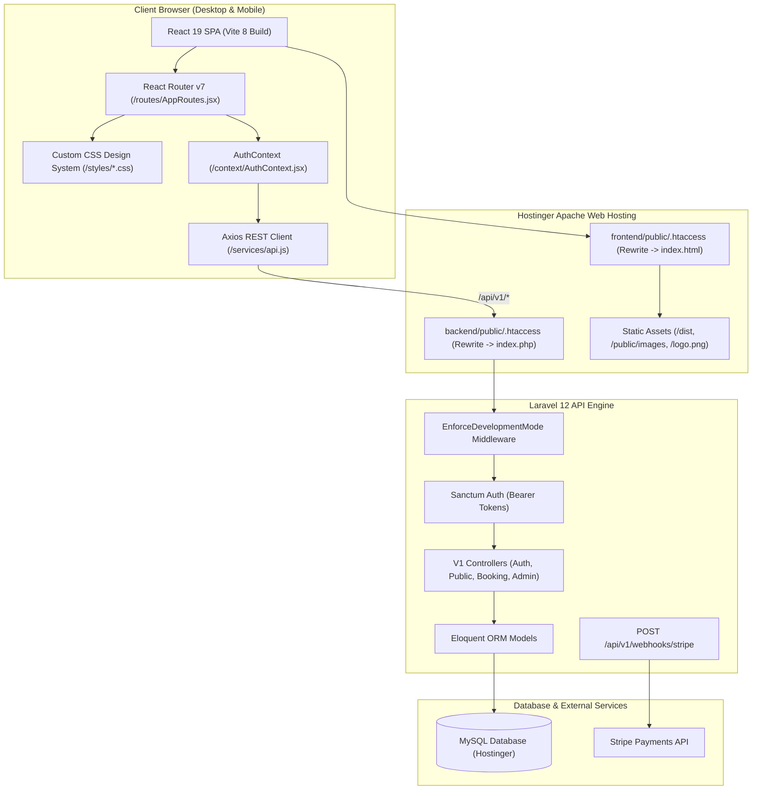
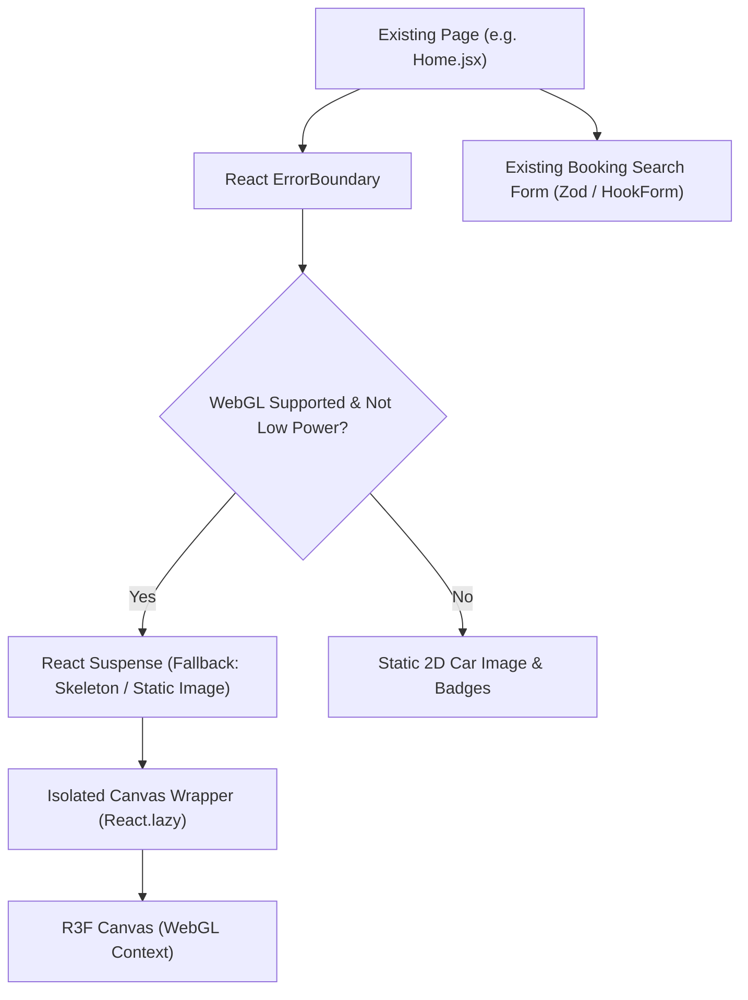

# 3D Tech Stack Audit & WebGL Integration Feasibility Report
**Project:** A1 Smart Driving (`smartdriving`)  
**Architecture Role:** Senior Full-Stack Architect & WebGL / Three.js Engineer  
**Date of Audit:** November 23, 2026  
**Status:** Audit & Feasibility Completed (Analysis Only — Zero Application Code Modified)

---

## Executive Summary

The **A1 Smart Driving** platform is built on a modern decoupled architecture:
- **Frontend:** React 19 (`19.3.1`) powered by Vite (`8.3.5`) and React Router v7 (`7.18.5`), utilizing an isolated custom CSS variable-driven design system.
- **Backend:** Laravel 12 (`12.70.2`) on PHP 8.2 (`8.2.4`) with Laravel Sanctum (`4.3.3`) for token authentication, Eloquent ORM, and Stripe PHP SDK (`23.1.0`).
- **Hosting Environment:** Apache shared hosting / VPS on Hostinger configured via `.htaccess` rewrite rules (`frontend/public/.htaccess` and `backend/public/.htaccess`).

### Key Feasibility Findings:
1. **Can this project support high-end 3D (Lusion / Active Theory style)?**
   **YES, ABSOLUTELY.** Client-side WebGL / Three.js executes 100% on the user's browser GPU. The current Vite 8 + React 19 stack is an outstanding foundation for WebGL rendering.
2. **Framework Migration Needed?**
   **NO.** There is zero need to migrate to Next.js or any other framework. Vite 8 provides instant Rollup code-splitting, HMR, and ultra-fast static asset serving.
3. **Does Hostinger Support 3D?**
   **YES.** WebGL scenes require no server-side GPU rendering. Hostinger only serves static compiled JavaScript bundles and compressed 3D assets (`.glb`, `.bin`, `.ktx2`), which any standard web server can do efficiently when proper caching and compression headers are in place.
4. **React 19 Compatibility Note:**
   `@react-three/fiber` (`v9.8.2+`) and `@react-three/drei` (`v10.7.9+`) officially support React 19. A dry-run resolution confirmed zero dependency conflicts.
5. **Safest First 3D Feature:**
   An **Isolated 3D Hero Car Showcase** in `frontend/src/components/home/Hero.jsx` (replacing or augmenting the static `sdh-visual` container) using an asynchronous dynamic `React.lazy` canvas wrapper with fallback placeholders, camera controls, mouse tilt, and Draco-compressed assets.

---

## Phase 1 — Complete Project Analysis & Dependency Inventory

### 1.1 Complete Technology Audit Table

| # | Technology Category | Detected Technology | Exact Installed Version | Purpose in this Project | Verification File Path | Implementation Status |
|---|---|---|---|---|---|---|
| **1** | Frontend Framework | React | `19.3.1` | Core UI component engine | `frontend/package-lock.json` | **Actively Used** |
| **2** | DOM Renderer | React DOM | `19.3.1` | DOM reconciliation and rendering | `frontend/package-lock.json` | **Actively Used** |
| **3** | Client Routing | React Router DOM | `7.18.5` | Client-side SPA route management | `frontend/src/routes/AppRoutes.jsx` | **Actively Used** |
| **4** | Frontend Build Tool | Vite | `8.3.5` | ES module dev server & Rollup bundler | `frontend/vite.config.js` | **Actively Used** |
| **5** | Vite React Plugin | `@vitejs/plugin-react` | `6.3.0` | Babel / Fast Refresh React compiler | `frontend/package.json` | **Actively Used** |
| **6** | Backend Framework | Laravel Framework | `12.70.2` | REST API, database access & webhooks | `backend/composer.lock` | **Actively Used** |
| **7** | API Authentication | Laravel Sanctum | `4.3.3` | SPA Bearer token authentication | `backend/composer.lock` | **Actively Used** |
| **8** | Payment Gateway SDK | `stripe/stripe-php` | `23.1.0` | Checkout sessions & webhook signatures | `backend/composer.lock` | **Actively Used** |
| **9** | Runtime Environment | Node.js | `v22.13.0` | Frontend package execution and bundling | System runtime (`node -v`) | **Actively Used** |
| **10** | Package Manager | npm | `10.9.2` | Frontend package dependency resolution | `frontend/package-lock.json` | **Actively Used** |
| **11** | Backend Language | PHP | `8.2.4` | Backend server execution engine | System runtime (`php -v`) | **Actively Used** |
| **12** | CSS Utility Framework | Tailwind CSS | `4.3.3` | Installed utility CSS package | `frontend/package.json` | **Configured but Unused** |
| **13** | CSS Post-processor | PostCSS | `8.5.32` | CSS transform processing | `frontend/package-lock.json` | **Installed** |
| **14** | CSS Vendor Prefixer | Autoprefixer | `10.6.2` | Automatic vendor CSS prefixing | `frontend/package-lock.json` | **Installed** |
| **15** | Design System / CSS | Custom CSS System | Modular (`v1.0`) | Primary UI styling (`variables.css`, etc.) | `frontend/src/styles/variables.css` | **Actively Used** |
| **16** | Icons Library | Lucide React | `1.62.0` | SVG UI icons throughout the site | `frontend/src/components/layout/Navbar.jsx` | **Actively Used** |
| **17** | HTTP Client | Axios | `1.21.0` | API requests to Laravel backend | `frontend/src/services/api.js` | **Actively Used** |
| **18** | Form Management | React Hook Form | `7.91.0` | Form state, validation & submission | `frontend/package.json` | **Actively Used** |
| **19** | Schema Validation | Zod | `4.6.7` | Input validation schema rules | `frontend/package.json` | **Actively Used** |
| **20** | Form Resolver | `@hookform/resolvers` | `6.0.1` | Zod connector for React Hook Form | `frontend/package.json` | **Actively Used** |
| **21** | 3D / WebGL / Three.js | None | N/A | No 3D libraries currently exist | `frontend/src/` | **Not Detected** |
| **22** | Animation Libraries | None (Only CSS) | N/A | CSS keyframes (`spin`, `sd-dropdown-in`) | `frontend/src/styles/components.css` | **Not Detected** |
| **23** | State Management | React Context API | Native | Authentication & site status tracking | `frontend/src/context/AuthContext.jsx` | **Actively Used** |
| **24** | Database Engine | MySQL / SQLite | 8.0+ / 3.x | Relational DB for users, bookings, settings | `backend/config/database.php` | **Actively Used** |
| **25** | Database ORM | Eloquent ORM | Native (12.x) | Model queries, relations, scopes | `backend/app/Models/User.php` | **Actively Used** |
| **26** | Web Server / Hosting | Apache (`mod_rewrite`) | 2.4+ | Hostinger shared host / VPS static & API routing | `frontend/public/.htaccess` | **Actively Used** |

---

### 1.2 Deep Dive: Existing Project Architecture



#### Detailed Architecture Findings:
- **Styling Architecture:** The frontend is **not** actively using Tailwind CSS. It is styled entirely using modular CSS files located in `frontend/src/styles/` (`variables.css`, `global.css`, `layout.css`, `components.css`, `responsive.css`, `navbar.css`, `hero.css`, etc.) and CSS custom properties (`--color-primary: #1B6C31`, `--color-secondary: #0D2645`). This means 3D canvases can be positioned using clean CSS classes (`.sd-canvas-container`, `.sd-3d-hero`) without fighting Tailwind utility conflicts.
- **Bundler & Code Splitting:** `frontend/vite.config.js` defines manual chunks:
  - `vendor-react`: `react`, `react-dom`, `react-router-dom`
  - `vendor-icons`: `lucide-react`
  - `vendor`: Remaining third-party dependencies
  - Current bundle output size: ~452 KB uncompressed (~88 KB gzip).
- **Responsive System:** Well-structured media queries in `frontend/src/styles/responsive.css` covering Desktop (>1024px), Tablet (<=1024px), Mobile (<=768px), and Small Mobile (<=480px).
- **Asset State:** Images are currently stored in `frontend/public/images/` (`hero-car.jpg` at 132 KB, `hero-driving.jpg` at 217 KB, and logos at 129 KB). No WebP/AVIF compression or 3D asset loaders exist yet.

---

## Phase 2 — Professional 3D Integration Feasibility Matrix

The following matrix evaluates each high-end 3D capability against this specific project stack (React 19 + Vite 8 + Laravel + Hostinger):

| Feature | Compatibility | Difficulty | Performance Impact | Required Packages | Integration Location | Implementation Recommendation |
|---|---|---|---|---|---|---|
| **Three.js Core** | **Yes** | Easy | Medium | `three` | `frontend/src/components/3d/` | Mount inside a dedicated `<canvas>` container with proper resize & disposal handling. |
| **React Three Fiber (R3F)** | **Yes** | Medium | Medium | `@react-three/fiber` (v9+) | `frontend/src/components/3d/CanvasContainer.jsx` | Use R3F v9 with React 19 reconciler. Enclose inside `Suspense` and `ErrorBoundary`. |
| **Drei Utilities** | **Yes** | Easy | Low–Medium | `@react-three/drei` (v10+) | `frontend/src/components/3d/` | Use `<OrbitControls>`, `<Environment>`, `<Float>`, `<ContactShadows>`, and `<useGLTF>`. |
| **GSAP & ScrollTrigger** | **Yes** | Medium | Low | `gsap` | `frontend/src/hooks/useGsapTimeline.js` | Drive camera position (`camera.position.set`) and mesh rotations based on scroll scrub. |
| **Lenis Smooth Scroll** | **Yes** | Easy | Low | `lenis` | `frontend/src/layouts/PublicLayout.jsx` | Synchronize Lenis scroll ticker with `gsap.ticker` to eliminate stutter during 3D scroll scrubbing. |
| **Blender GLB / GLTF Models** | **Yes** | Medium | Medium–High | `three` (GLTFLoader), `draco3d` | `frontend/public/models/*.glb` | Optimize models in Blender: bake textures, join meshes, apply Draco/Meshopt compression. |
| **Interactive 3D Hero Section** | **Yes** | Medium | Medium | `@react-three/fiber`, `@react-three/drei` | `frontend/src/components/home/Hero.jsx` (replaces `.sdh-visual`) | Lazy-load canvas; keep HTML booking form accessible on the left; show fallback image while loading. |
| **Realistic Car / Vehicle Model** | **Yes** | Advanced | High | `@react-three/fiber`, `@react-three/drei` | `frontend/src/components/3d/CarModel.jsx` | Use PBR materials (MeshPhysicalMaterial for clearcoat paint), 1k/2k baked roughness maps, and HDR environment. |
| **360° Interactive Rotation** | **Yes** | Easy | Low | `@react-three/drei` (`<OrbitControls>`) | `frontend/src/components/3d/SceneViewer.jsx` | Limit polar angles (`minPolarAngle={Math.PI / 4}`, `maxPolarAngle={Math.PI / 2}`) to prevent camera flipping under the ground. |
| **Mouse-Following 3D Objects** | **Yes** | Easy | Low | Native R3F `useFrame` or `@use-gesture/react` | `frontend/src/components/3d/InteractiveCar.jsx` | Smooth lerp mesh rotation based on normalized mouse coordinates `(state.pointer.x, state.pointer.y)`. |
| **Scroll-Driven Camera Moves** | **Yes** | Medium | Medium | `gsap`, `ScrollTrigger` | `frontend/src/components/home/Home3DScrollExperience.jsx` | Move camera through 3 waypoints as user scrolls down through "Why PreVORT" and "Services". |
| **Cinematic Transitions** | **Yes** | Advanced | Medium | `gsap`, postprocessing (optional) | `frontend/src/components/3d/CameraRig.jsx` | Animate camera FOV, bloom threshold, or depth of field when switching views. |
| **Realistic Lighting & Reflections** | **Yes** | Medium | Medium | `@react-three/drei` (`<Environment>`, `<ContactShadows>`) | `frontend/src/components/3d/Lighting.jsx` | Use studio HDR lighting presets with soft contact shadows; avoid heavy multi-point real-time shadow maps. |
| **Interactive 3D Backgrounds** | **Yes** | Medium | Medium | Three.js shader material / points | `frontend/src/components/3d/RoadParticles.jsx` | GPU instanced particles or undulating road spline mesh running on `useFrame`. |
| **3D Car Customizer / Configurator** | **Yes** | Medium | Low–Medium | `zustand` | `frontend/src/components/3d/CarConfigurator.jsx` | Let learners choose car color (e.g., A1 Green, Midnight Blue, Silver) by updating material colors dynamically. |
| **Mobile-Responsive 3D Experience** | **Partial** | Advanced | High | `@react-three/drei` (`PerformanceMonitor`) | `frontend/src/components/3d/ResponsiveCanvas.jsx` | Lower resolution (`dpr={[1, 1.5]}`), disable postprocessing, and substitute high-poly models on low-power devices. |

---

## Phase 3 — Recommended Technology Stack

### Current vs. Proposed Stack Comparison

| Technology | Proposed Role | Keep Current or Adopt? | Justification & Architectural Impact |
|---|---|---|---|
| **React 19** | Core UI | **Keep Current (`19.3.1`)** | Fully supported by latest R3F v9. No migration needed. |
| **Vite 8** | Build Tool | **Keep Current (`8.3.5`)** | Extremely fast bundling, native ES modules, supports Rollup 3D chunk splitting. |
| **Custom CSS** | UI Styling | **Keep Current** | Clean separation of concerns. Do not force Tailwind rewrite. |
| **Three.js** | 3D Engine | **Adopt (`three@^0.170+`)** | The undisputed standard for WebGL / WebGPU in the browser. |
| **React Three Fiber** | 3D React Bridge | **Adopt (`@react-three/fiber@^9.0+`)** | Declarative Three.js components with automatic disposal and React lifecycle. |
| **Drei** | R3F Helpers | **Adopt (`@react-three/drei@^10.0+`)** | Provides pre-built loaders, camera controls, environment maps, and shadow helpers. |
| **GSAP + ScrollTrigger** | Animation Engine | **Adopt (`gsap@^3.12+`)** | Professional timeline sequencing for scroll scrubbing and camera choreographies. |
| **Lenis** | Smooth Scroll | **Adopt (`lenis@^1.1+`)** | Prevents native scroll tearing during WebGL camera scrubbing on Windows/Chrome. |
| **Zustand** | 3D Scene State | **Adopt (`zustand@^5.0+`)** | Micro-state manager for 60fps mouse/color updates outside React render cycle. |
| **Blender** | 3D Asset Creation | **Adopt (Workflow Tool)** | Industry-standard DCC for car modeling, UV unwrapping, and GLB export. |
| **GLB / GLTF + Draco** | 3D File Format | **Adopt (Asset Standard)** | Minimal binary format with geometry compression for fast web transmission. |

> [!TIP]
> **Minimalist Recommendation:**
> Only install `three`, `@react-three/fiber`, and `@react-three/drei` first. Do not add physics engines (Rapier), post-processing, or heavy particle systems until the base 3D canvas and model are working smoothly.

---

## Phase 4 — Existing Website Safety & Isolation Strategy

Integrating 3D must never compromise the mission-critical business operations of A1 Smart Driving:
- Online VORT test & driving lesson bookings
- Stripe payment processing
- Admin availability and booking schedules
- Instructor portal and SMS authentication

### Safety Architecture



### Safety Rules & Protective Measures:
1. **Zero Interference with Forms and Buttons:**
   The 3D Canvas must have `pointer-events: none` on its container except for elements explicitly meant for 3D interaction, ensuring search dropdowns, date pickers, and CTA buttons never lose focus or clickability.
2. **Dynamic Lazy Loading (`React.lazy`):**
   The entire 3D bundle (~500 KB uncompressed Three.js engine) must be lazy-loaded using `React.lazy()` and `Suspense`. Visitors on slow 3G connections will see the existing static visual immediately without blocking the critical first paint or Time-to-Interactive (TTI).
3. **Graceful WebGL Failure Handling:**
   If a user's browser has hardware acceleration disabled or WebGL is blocked, an `ErrorBoundary` catches the failure and silently renders the existing high-resolution `hero-car.jpg`.
4. **Reduced-Motion Preference Support:**
   Respect `window.matchMedia('(prefers-reduced-motion: reduce)')`. When active, freeze automatic camera rotations and floating animations, rendering a static 3D perspective.
5. **Memory Leak Prevention:**
   Three.js textures and geometries do not get garbage-collected automatically by React. When components unmount (e.g., navigating from `/` to `/book-test`), all geometries, materials, and textures must be disposed (`dispose()`). R3F handles this automatically for declarative elements.

---

## Phase 5 — Performance, WebGL & Hosting Analysis

### 5.1 Hostinger Hosting Suitability

| Hosting Layer | Capability on Hostinger | Impact on 3D Features |
|---|---|---|
| **Server CPU / RAM** | Standard Shared / Cloud VPS | **Zero impact.** WebGL rendering runs 100% on the client browser. Hostinger simply serves static files. |
| **Network Bandwidth** | Unmetered on Hostinger | **Safe.** Proper caching and gzip/brotli compression ensures low bandwidth consumption. |
| **Static File Mime Types** | Apache `.htaccess` | Needs `.glb` and `.gltf` MIME type definitions in `.htaccess` to allow byte-range streaming. |
| **Cache Headers** | Apache `mod_expires` | 3D models and textures should be cached with `Cache-Control: public, max-age=31536000, immutable`. |

#### Required Apache `.htaccess` Additions for 3D Assets:
```apache
<IfModule mod_mime.c>
  AddType model/gltf-binary .glb
  AddType model/gltf+json   .gltf
  AddType image/ktx2        .ktx2
</IfModule>

<IfModule mod_expires.c>
  ExpiresActive On
  ExpiresByType model/gltf-binary "access plus 1 year"
  ExpiresByType model/gltf+json   "access plus 1 year"
  ExpiresByType image/ktx2        "access plus 1 year"
</IfModule>
```

### 5.2 Client Performance Budget & Optimization Targets

- **Target Framerate:** Solid **60 FPS** on desktop, **30–60 FPS** on mid-range mobile.
- **Maximum 3D Asset Size:**
  - Total GLB file: **< 2.5 MB** (compressed with Draco to ~600 KB – 1 MB).
  - Textures: **1024x1024** maximum (PBR roughness, normal, base color). Avoid 4K textures completely.
  - Draw Calls: **< 50 draw calls** per frame.
  - Polygon Count: **< 50,000 triangles** for the car model.
- **Device Pixel Ratio (DPR):** Clamp DPR to `[1, 1.8]` (`dpr={[1, 1.8]}`). Never allow DPR 3.0 on Retina iPhones, as shading 3x pixels kills mobile GPUs with zero visible benefit.
- **Power Optimization:** Use R3F's `frameloop="demand"` for scenes that only update on user drag/hover, conserving laptop battery and mobile CPU.

---

## Phase 6 — Phased Implementation Roadmap

```mermaid
flowchart LR
    S1["Stage 1: Audit & Lockfile Validation"] --> S2["Stage 2: Minimal 3D Dependencies"]
    S2 --> S3["Stage 3: Isolated Sandbox Scene"]
    S3 --> S4["Stage 4: Professional 3D Hero"]
    S4 --> S5["Stage 5: GSAP Scroll Animations"]
    S5 --> S6["Stage 6: Optimized Blender GLB Asset"]
    S6 --> S7["Stage 7: Selective Page Integration"]
    S7 --> S8["Stage 8: Mobile & Perf Optimization"]
    S8 --> S9["Stage 9: Production Build & Deploy"]
```



### Stage Breakdown

| Stage | Name | Complexity | Affected Files | Dependencies Required | Verification & Testing |
|---|---|---|---|---|---|
| **Stage 1** | Audit & Lockfile Validation | Low | None (Read-only) | None | Verify peerDependencies and dry-run install. *(Completed in this audit)* |
| **Stage 2** | Install Minimal 3D Stack | Low | `frontend/package.json`, `package-lock.json` | `three`, `@react-three/fiber`, `@react-three/drei` | Run `npm run build` to ensure clean build with zero warnings. |
| **Stage 3** | Isolated Sandbox Scene | Low | `frontend/src/components/3d/SandboxScene.jsx` | R3F primitives | Render a spinning 3D car geometry or primitive cube in isolation. |
| **Stage 4** | Professional 3D Hero Section | Medium | `frontend/src/components/home/Hero.jsx`, `frontend/src/components/3d/HeroScene.jsx` | `@react-three/drei`, `three` | Replace static visual with lazy-loaded canvas; verify form accessibility. |
| **Stage 5** | GSAP Scroll Integration | Medium | `frontend/src/components/3d/CameraRig.jsx`, `PublicLayout.jsx` | `gsap`, `lenis` | Test smooth scroll scrubbing of camera angles on desktop and mobile. |
| **Stage 6** | Blender Model Optimization | Medium | `frontend/public/models/training-car.glb` | Blender (external), `draco3d` | Compress model to < 1.5MB; inspect realistic PBR car paint in Drei canvas. |
| **Stage 7** | Selective Page Integration | Medium | `frontend/src/pages/HowItWorks.jsx`, `FirstLesson.jsx` | R3F components | Add 360° vehicle inspection or road scenario diagrams to resource pages. |
| **Stage 8** | Mobile & Performance Hardening | High | `frontend/src/components/3d/ResponsiveCanvas.jsx` | `@react-three/drei` | Test on low-end Android & iPhone; verify FPS >= 30 and fallback behavior. |
| **Stage 9** | Production Build & Deployment | Low | `frontend/vite.config.js`, `frontend/public/.htaccess` | None | Run `npm run build`, upload to Hostinger, and test live site performance. |

---

## Phase 7 — Exact Installation & Configuration Commands

*(For reference only — do not run until explicitly approved)*

### Recommended NPM Install Command
```bash
cd frontend
npm install three @react-three/fiber @react-three/drei gsap lenis zustand
```

### Vite Configuration Update (`frontend/vite.config.js`)
Add Three.js vendor chunking to keep the main bundle ultra-light:
```javascript
manualChunks(id) {
  if (id.includes('node_modules')) {
    if (id.includes('three') || id.includes('@react-three')) {
      return 'vendor-three';
    }
    if (id.includes('gsap') || id.includes('lenis')) {
      return 'vendor-animation';
    }
    if (id.includes('react') || id.includes('react-dom') || id.includes('react-router-dom')) {
      return 'vendor-react';
    }
    if (id.includes('lucide-react')) {
      return 'vendor-icons';
    }
    return 'vendor';
  }
}
```

### Recommended Folder Structure for 3D Components
```
frontend/src/
├── components/
│   ├── 3d/
│   │   ├── CanvasContainer.jsx      # Lazy-loaded canvas wrapper with ErrorBoundary & Suspense
│   │   ├── CarModel.jsx             # GLTF model with PBR paint materials
│   │   ├── CameraRig.jsx            # Mouse-following lerp & GSAP scroll camera logic
│   │   ├── EnvironmentLighting.jsx  # HDR lighting & contact shadows
│   │   ├── FallbackHeroImage.jsx    # Accessible 2D placeholder during load
│   │   └── HeroScene.jsx            # Composition of 3D scene elements for Home hero
```

---

## Final Architect Recommendation

1. **Proceed with 3D Integration:** The project architecture is in optimal condition. The React 19 + Vite 8 stack is completely compatible with modern Three.js and React Three Fiber v9.
2. **Keep Existing Stack:** Do not rewrite or migrate any framework, styling, or backend code.
3. **Safe First Step:** When ready, start with **Stage 2 & 3** (install minimal packages and build a hidden, isolated 3D sandbox component) to verify WebGL canvas rendering without touching any existing public pages.
